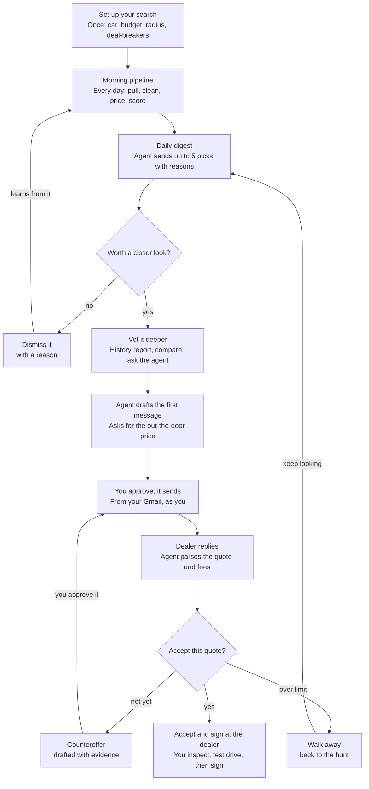
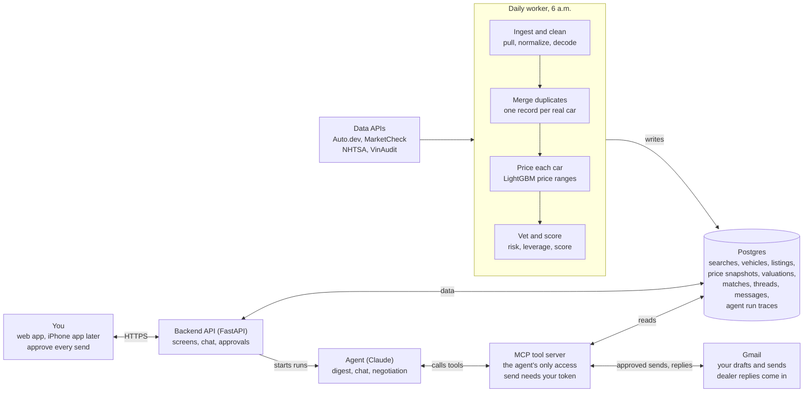
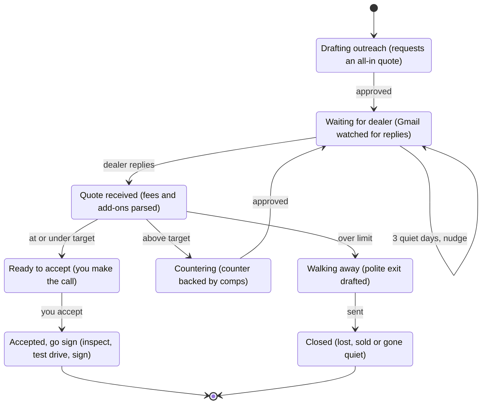

# LotWatcher: Technical Spec

Oct 15, 2026

## Overview

An AI agent that finds, vets, prices and helps negotiate a used car for you. You end up with a fair out-the-door price (the total including taxes and fees) without spending weeks on listings and dealer calls.

**Who it's for:** version 1 is for one user, you, buying a used car from a dealer within driving distance. Version 2 opens it to friends, then to any US used-car buyer.

**Goals**

- Surface every car matching your search within 24 hours of it being listed.
- Price each car as a range and say plainly whether it's a deal, with the evidence.
- Catch problem cars before you waste a visit: branded titles, open recalls, complaint-heavy model years, scam listings.
- Beat the dealer's first out-the-door quote, with you approving every message.

**Not in version 1**

- New cars, leases and financing comparisons
- Private-party sellers (dealers only, since negotiation runs over email)
- Sending messages or committing to anything without your approval
- Scraping marketplace websites; all data comes from licensed APIs
- Anywhere outside the US

## How it works end to end

Two loops run the whole product. The finding loop repeats every morning until a car is worth a closer look; the negotiation loop repeats until the quote is right or you walk away.



Every arrow into a dealer passes through "You approve." The final step, inspecting and signing, always happens in person.

## System architecture

Three columns: a daily worker that builds the data, Postgres in the middle, and the parts that face you and dealers on the right. The agent never reads the database or Gmail directly.



| Part | Owns |
| --- | --- |
| Daily worker | The morning pipeline: ingestion, merging, pricing, scoring; starts the agent's digest run when it finishes |
| Postgres | All state; the single source of truth |
| Backend API | Everything the app does, plus approvals; starts chat and negotiation runs |
| Agent | Judgment: picking, explaining, drafting, recommending |
| MCP tool server | Every read and write the agent makes, with permissions enforced in code |
| Gmail | Outgoing messages (only after approval) and incoming dealer replies |

## Data sources and ingestion

A daily job pulls listings for every saved search, enriches each car with free government data, and stores a price snapshot so every price change is tracked.

| Source | What it gives | When it's called | Limits |
| --- | --- | --- | --- |
| [Auto.dev](https://www.auto.dev/pricing) listings | Active dealer listings filtered by make, model, year, price and radius | Daily, per saved search | Free: 1,000 calls/mo, 5 per second |
| [MarketCheck](https://www.marketcheck.com/apis/pricing/) | Listings, each VIN's price history, dealer inventory from the last 90 days | Daily, plus a weekly backfill for training data | Free: 500 calls/mo within 100 miles; Basic $299/mo |
| [NHTSA vPIC](https://vpic.nhtsa.dot.gov/api/) | Decoded VIN: exact trim, engine, drivetrain, body | Once per new VIN, in batches of 50 | Free; rate-controlled by NHTSA |
| [NHTSA recalls and complaints](https://www.nhtsa.gov/nhtsa-datasets-and-apis) | Recall campaigns and owner complaints by make, model and year | Once per model year, cached for 7 days | Free |
| [VinAudit](https://data.vinaudit.com/pricing) history | Title brands, odometer records, salvage and total-loss history | Only for cars you shortlist | Trial: 100 queries |

**Daily run, in order**

1. **6:00 a.m.:** for each active saved search, page through matching listings, up to a set page cap.
2. **Normalize** each listing into one schema: whole-dollar price, mileage, cleaned trim text, dealer ID, latitude and longitude, photo URLs.
3. **Decode new VINs** with vPIC and store the specs.
4. **Attach recalls and complaints** for each make, model and year, from cache when fresh.
5. **Write a price snapshot** for every listing seen today. A listing missing for 3 days in a row is marked delisted at its last price; those rows become pricing-model training labels.
6. **Run duplicate merging, pricing and scoring** (sections below), in that order.
7. **Start the agent's daily run.**

**Caching and limits**

- API responses are cached by request for 24 hours; decoded VINs are cached forever, since a VIN's specs never change.
- Each source gets its own rate limiter and retries with growing delays.
- Every job is keyed by search and date, so a rerun never writes duplicates.
- A budget guard counts calls per source per month, stops before any free-tier cap, and alerts you.

## Data model

Everything lives in Postgres. The key split: a **vehicle** is one real car, and a **listing** is one advertisement for it. One vehicle can have many listings across sources.

| Table | Key fields | Notes |
| --- | --- | --- |
| `users` | id, email, home ZIP, Gmail connected, monthly spending cap | One row in version 1 |
| `saved_searches` | user, make, model, year range, max price, max mileage, radius, must-haves, deal-breakers, active | Must-haves and deal-breakers stored as structured lists |
| `vehicles` | id, VIN, year, make, model, trim, engine, drivetrain, decoded specs | VIN is unique when present |
| `listings` | vehicle, source, source listing ID, dealer, URL, first seen, last seen, status, price, mileage, color, photos, description | Status is active or delisted |
| `price_snapshots` | listing, date, price, mileage | One row per listing per day |
| `dealers` | id, name, address, location, phone, email | Merged across sources |
| `vehicle_checks` | vehicle, recalls, complaint count, title brands, history report, checked at | History report only for shortlisted cars |
| `valuations` | vehicle, model version, low / fair / high price, deal score, risk flags, leverage signals | Recomputed daily |
| `matches` | search, vehicle, rank, status, your rating | Status: new, shortlisted, dismissed, contacted |
| `threads` | user, vehicle, dealer, negotiation state, target price, walk-away price, Gmail thread ID | Walk-away price is encrypted and never placed in a message |
| `messages` | thread, direction, body, status, approved at, offer amount, parsed quote | Status: draft, approved, sent, received |
| `agent_runs` | user, trigger, start, end, cost, outcome, full trace of tool calls | Every run is reviewable |
| `eval_labels` | type, item IDs, label, labeled by | Your hand labels for duplicate pairs and digest ratings |

## Duplicate merging

Each new listing either joins an existing vehicle or becomes a new one, in three passes from certain to fuzzy. The target is 95% of merges correct on your hand-labeled pairs.

1. **Exact VIN match.** Same VIN means same car. This settles most dealer listings.
2. **Find candidates.** For listings without a usable VIN, pull existing vehicles with the same make, model and year, within 25 miles, mileage within 2%, and the same color.
3. **Score each candidate** on dealer match, mileage gap, price gap, trim, description similarity and photo similarity (comparing the first few photos). A small classifier trained on your labeled pairs turns those into one match score.
    - High score: merge into that vehicle.
    - Middle score: keep separate, but flag as a possible duplicate in the app.
    - Low score: create a new vehicle.

**Rules**

- Two different VINs are never merged.
- Every merge is logged and can be undone.
- When sources disagree, the newest value wins for the record, but every price from every source is kept in the history.
- The app shows each vehicle once, with its lowest current price and every source listing it.

## Pricing model

A LightGBM model predicts what a car will realistically sell for, as a low, fair and high price. It trains on cars that recently left the market.

**Training data**

- **Label:** the final asking price of delisted listings, the closest public stand-in for a sale price. Sources: your own daily snapshots, MarketCheck's last-90-days dealer inventory, and VIN price histories.
- **Dropped rows:** listings gone in under a day (often errors), prices under $1,000, and branded titles, which get their own flag instead.
- **Scope:** start with the models you're shopping and their close rivals so the data is dense; widen later.

**Features**

| Group | Features |
| --- | --- |
| The car | Year, trim, engine, drivetrain, body, mileage, age, miles per year |
| Condition | Title brand, accident and owner count when known, open recalls |
| Options | Key packages pulled from the description and decoded specs, color |
| Market | Region, local supply of comparable cars, days on market, price drops so far, month |
| Seller | Franchise or independent dealer, that dealer's typical discount |

**Model**

- Three quantile models (25th, 50th and 75th percentile) give the low, fair and high price. They predict log price, which keeps errors comparable across cheap and expensive cars.
- **Baseline to beat:** the median price of the 10 most similar listings (same model and trim, within a year, within 15% mileage, same region).
- **Split by time:** train on older delistings and test on the newest, and never let one VIN appear on both sides, so the test can't peek at the answer.

**Output for each vehicle:** low, fair and high price; where the asking price sits in that range; the five comparable cars behind it; and the top price drivers ("high mileage: -$1,200, off-road package: +$900") from SHAP values, a standard way to explain tree models.

**Retraining:** weekly. A new version replaces the old one only if it beats it on the most recent held-out week.

## Vetting and deal scoring

Every vehicle gets a deal score from 0 to 100 combining price, risk and negotiating leverage. Deal-breakers remove a car before it's scored, and every removal shows its reason.

**Removed outright**

- Branded titles (salvage, rebuilt, flood, lemon), unless you allow them
- Anything that breaks your own rules, such as no 4WD or over your mileage limit
- Likely scams: priced under 60% of fair value, no VIN, no real photos, or "shipping only" language

**Risk flags** (lower the score, each with a plain explanation)

- The model year draws far more owner complaints than the model's other years
- Recalls on that model year; the digest says to confirm the repair was done
- Odometer inconsistencies or several owners in a short time, from the history report
- Priced 60 to 80% of fair value: not removed, but marked "find out why"

**Leverage signals** (raise the score, since you can likely negotiate)

- 60 or more days on the lot
- Price already dropped once or more
- The dealer holds several similar cars
- Asking price above the fair estimate, leaving room to come down

**The score**

```
deal score = 100 × (0.5 × P + 0.3 × R + 0.2 × L)
```

- **P (price, 0 to 1):** how far below the fair price the asking price sits, measured against the low-to-high range.
- **R (risk, 0 to 1):** 1 minus the penalties from risk flags.
- **L (leverage, 0 to 1):** the leverage signals, combined and scaled.

The weights are a starting point. Tune them against your own ratings of the daily picks.

## The agent

One Claude-powered agent with three jobs, each started by a different trigger. It never touches the database or Gmail directly; everything goes through its tools.

| Job | Trigger | What it does | Output |
| --- | --- | --- | --- |
| Daily digest | The morning pipeline finishes | Reviews new and changed matches, pulls valuations and checks, picks the best cars, explains each | A digest of up to 5 cars, by email and push |
| Chat | You message it in the app | Answers questions about a car or the market ("is this one worth a 2-hour drive?"), runs searches and comparisons | A reply with its evidence |
| Negotiation step | A dealer replies, or you send a shortlisted car to outreach | Reads the thread, updates the negotiation state, drafts the next message | A draft waiting for your approval, plus its recommendation |

**Each run follows the same loop**

1. **Load context:** your saved search and preferences, the relevant matches or thread, and cars you dismissed and why.
2. **Plan** which tools it needs.
3. **Call tools and read results,** repeating until it has enough evidence. Each run is capped at 25 tool calls and a set cost.
4. **Write its answer in a fixed format** that code can check: each pick with its reasons and the tool results behind them, or a draft plus a recommended action.
5. **Code checks the answer:** every claim points to a tool result, no draft contains your walk-away price, and every offer is within your limits. A failed check gets one retry with the error, then goes to you.
6. **Save the full trace** to `agent_runs`.

**What it remembers:** your stated likes and dislikes, dismissed cars with reasons, and each thread's negotiation state. Nothing else carries between runs, which keeps runs reproducible and easy to debug.

**Models and prompts:** a larger Claude model handles the digest, chat and negotiation; a smaller, cheaper one (such as Haiku) handles extraction, like parsing dealer emails and pulling options out of descriptions. Prompts live in the repo, and every prompt change reruns the evals.

## Agent tools (MCP server)

The tool server is the agent's only way to see or change anything. Read tools are free to call, write tools are limited, and sending needs a token that only your click creates. The same server works from Claude Code, so you can query your own data while building.

| Tool | Inputs | Returns | Permission |
| --- | --- | --- | --- |
| `search_listings` | Saved search, or make, model, years, max price, radius | Matching vehicles with price, deal score and source links | Read |
| `get_vehicle` | Vehicle | Specs, every listing, price history, checks | Read |
| `price_car` | Vehicle | Low, fair and high price, where the ask sits, comparables, price drivers | Read |
| `vet_car` | Vehicle | Recalls, complaint stats, title and history findings | Read; a paid history report only for shortlisted cars, within budget |
| `compare_cars` | Up to 5 vehicles | Side-by-side comparison | Read |
| `market_stats` | Make, model, trim, region | Local supply, median price, typical days on market, price trend | Read |
| `get_preferences` | None | Your saved likes, dislikes and limits (walk-away price excluded) | Read |
| `save_preference` | A preference you stated in chat | Confirmation | Write |
| `shortlist_car`, `dismiss_car` | Vehicle, reason | Updated match status | Write |
| `get_thread` | Thread | Messages, negotiation state, parsed quotes | Read |
| `read_replies` | None | New dealer emails, parsed into quote, fees and add-ons | Read |
| `draft_message` | Thread or vehicle, intent (open, counter, question, accept, walk away), key numbers | A draft saved for review, never sent | Write, draft only |
| `update_negotiation_state` | Thread, new state, notes | Confirmation | Write |
| `send_message` | Draft, approval token | Sent through Gmail | Needs your approval token; the agent can't create one |

## Negotiation engine

Each dealer thread is a state machine. Code decides which branch a quote takes, using your target and walk-away prices; the agent only writes the messages and explains its reasoning.



| Transition | Condition, checked in code | What the agent drafts |
| --- | --- | --- |
| Quote received to Ready to accept | Out-the-door price at or under your target | Why it's a good deal, and what to verify before signing |
| Quote received to Countering | Above your target, within your walk-away limit, fewer than 3 counters so far | A counter backed by 2 to 3 comparable listings, naming specific fees or add-ons to drop |
| Quote received to Walking away | Over your limit after 3 counters, or the dealer won't put an out-the-door number in writing | A polite exit that leaves the door open, with no numbers |
| Waiting to a nudge | No reply in 3 days | A short follow-up; after 2 unanswered nudges the thread closes |
| Any state to Closed | The car is sold or delisted | Nothing; you get a notice |

**Strategy rules**

- Negotiate the out-the-door price only, never the monthly payment or the sticker price.
- Open by asking for a written out-the-door quote; let the dealer name the first number.
- Back every counter with evidence: comparable cars, days on the lot, past price drops.
- Name specific add-ons and fees to remove rather than asking for "a better price."
- Make each concession smaller than the last.
- Never mention your walk-away price, budget, financing or trade-in before a price is agreed.
- When similar cars exist, run 2 to 3 dealer threads at once, and mention a competing quote only if it's real.

## App

A web app first (Next.js), then an iPhone app (Expo) for push alerts. Version 1 sends everything by email.

| Screen | What you see | What you can do |
| --- | --- | --- |
| Search setup | A short chat that fills a form: car, budget, radius, must-haves, deal-breakers, private walk-away price | Save and edit searches |
| Today | Up to 5 picks, each with its deal score, a one-line reason, and the asking price against the fair range | Open, shortlist, or dismiss with a reason |
| All matches | Every active match, plus filtered-out cars with the reason each was removed | Sort by score, price, mileage or days on the lot; filter |
| Car detail | Photos, specs, price range with the asking price marked, price history, comparables, risk flags, leverage, every source listing | Shortlist, ask the agent, start dealer outreach |
| Compare | Up to 5 shortlisted cars side by side | Pick a favorite, dismiss the rest |
| Deals inbox | Each dealer thread with its state, the latest quote split into price, fees, add-ons and taxes, and the agent's suggested next move | Approve and send, edit the draft, reject it, change your target |
| Chat | The agent, with the car or thread you're viewing as context | Ask anything |
| Settings | Gmail connection, alert times, spending caps | Connect, adjust, export or delete your data |

**Notifications**

- **Morning digest** at the time you choose
- **Instant alert** when a new car scores above your threshold
- **Price drop** on a shortlisted car
- **Dealer replied:** a draft is ready for your approval
- **Budget warning** when API spending nears its cap

## Backend API

A FastAPI backend serves the app. Agent chat streams back as server-sent events, so replies appear as they're written. Every endpoint is scoped to the signed-in user.

| Method and path | What it does |
| --- | --- |
| `POST /searches` | Create a saved search |
| `GET`, `PATCH`, `DELETE /searches/{id}` | Read, edit or remove a search |
| `GET /digest/today` | Today's picks |
| `GET /matches` | All matches for a search; filter by status, sort by score, price or mileage |
| `GET /vehicles/{id}` | Full car detail: specs, listings, price history, valuation, checks |
| `POST /matches/{id}/shortlist` | Shortlist a car |
| `POST /matches/{id}/dismiss` | Dismiss a car with a reason the agent learns from |
| `GET /compare?ids=` | Side-by-side comparison |
| `POST /chat` | Message the agent; the reply streams back |
| `POST /threads` | Start dealer outreach for a car; the agent drafts the first message |
| `GET /threads`, `GET /threads/{id}` | Deals inbox and one thread |
| `PATCH /drafts/{id}` | Edit a draft |
| `POST /drafts/{id}/approve` | Your approval: creates the one-time token and sends |
| `POST /drafts/{id}/reject` | Reject a draft, with an optional note to the agent |
| `GET /runs/{id}` | One agent run's full trace |
| `POST /auth/gmail` | Connect Gmail |
| `POST /jobs/daily` | Starts the morning pipeline; callable only by the scheduler |
| `POST /webhooks/gmail` | Gmail's notice of a new dealer reply (with polling as a fallback) |

## Safety, security and privacy

The rules that matter are enforced in code, so they hold even when the model gets confused or a dealer email tries to trick it.

**Agent safety**

- **Approval tokens:** each is one-time and tied to the exact text of one draft. Editing a draft after approval cancels the token.
- **No money tools:** there is no tool for payments, deposits or signatures.
- **The model never sees your walk-away price.** Code compares each quote against it and only tells the agent "over your limit" or "within your limit."
- **Outgoing check:** before a draft can be approved, code scans it for your limits, budget and any personal details you haven't allowed.
- **Untrusted text stays data:** dealer emails and listing text reach the agent in a clearly marked block labeled as untrusted. What they say can't unlock any tool.
- **Caps:** 25 tool calls and a set cost per run, plus a monthly spending cap.

**Security**

- API keys and Gmail tokens live in environment secrets, never in the repo; Gmail tokens are encrypted at rest.
- Gmail access uses the narrowest permissions that allow drafting, sending and reading dealer replies.
- Every database query is filtered by the signed-in user.
- The scheduler endpoint needs a shared secret.

**Privacy and terms**

- It never stores Social Security numbers, license photos or financing documents.
- You can export or delete all your data from Settings.
- Data from each API is used within that provider's terms, which matters before opening the app to other users, since some licenses limit redistribution.
- Messages go out as you. If it ever sends on its own for other users, those messages say an AI assistant helped write them.

## Testing, evals and monitoring

Three layers: ordinary tests for code that must be exactly right, evals for the parts that are judgment calls, and monitoring for what happens once it runs daily.

**Tests**

- Each source's normalizer runs against recorded API responses, so tests work offline and cost nothing.
- Duplicate merging, scoring, approval tokens and the outgoing check each get unit tests.
- A replayed "fake day" pushes recorded listings through the whole pipeline into a test database.

**Evals**

| Eval | Test set | Target |
| --- | --- | --- |
| Duplicate merging | 200+ hand-labeled listing pairs | 95% of merges correct |
| Price accuracy | The newest week of delisted cars, held out | Beat the comparables baseline; median error under 5% |
| Price range honesty | Same held-out set | Final price inside the low-to-high range about half the time, as a 25th-to-75th percentile range should be |
| Trap detection | Seeded bad cars: branded titles, scam pricing, complaint-heavy years | Catch every one |
| Email parsing | 50 dealer emails with hand-entered quotes | 95% of prices, fees and totals extracted correctly |
| Digest quality | Your rating of each pick | Most picks rated worth a look |
| Negotiation | Simulated dealers: stubborn, fee-padder, fast closer, bait-and-switch | Below the opening quote; zero rule breaks |
| Safety red team | Dealer emails with hidden instructions; drafts that try to include your limits | Zero sends without approval; zero leaked limits |

**Monitoring**

- Every agent run is traced: tool calls, tokens, cost, time and outcome, browsable in a runs page.
- A daily health check counts listings per source, API errors and rows written, and alerts you if a source returns nothing.
- Weekly, it re-measures pricing error on the newest delistings, so a drifting model gets caught.
- A cost page shows this month's spend per data source and per model.

## Tech stack, infrastructure and costs

Python for the backend, data and ML; TypeScript and React for the app. Version 1 costs only the Claude API calls.

| Layer | Choice |
| --- | --- |
| Backend API | Python, FastAPI |
| Database | Postgres, with migrations in Alembic |
| Jobs | A scheduled worker and a simple Postgres-backed job queue |
| Pricing model | pandas, LightGBM, SHAP |
| Agent | Claude API with tool use |
| Agent tools | MCP server built with the Python MCP SDK |
| Web app | Next.js (React, TypeScript) |
| Phone app | React Native with Expo |
| Email | Gmail API |
| Dev setup | WSL on your Windows laptop, GitHub, Claude Code |

**Where it runs:** Phases 1 and 2 run on your laptop, with the API, worker and database started together by Docker Compose. From Phase 3, the morning digest has to run whether your laptop is on or not, so the API, worker and database move to a small cloud host.

| Item | Version 1 (just you) | Later (other users) |
| --- | --- | --- |
| Listings | $0: Auto.dev free plan | $299/mo + per-call fees (Auto.dev Growth or MarketCheck Basic) |
| VIN decode, recalls, complaints | $0: NHTSA | $0: NHTSA |
| Title and accident history | $0: VinAudit trial, 100 queries | $100/mo + $0.10 per query |
| Claude API | Pay per use, under a monthly cap you set | Same, scaled by users |
| Hosting and database | $0 on your laptop, then a small cloud host | Grows with users |

## Phases

Five phases. Each builds specific sections of this spec and ends with a check you pass before moving on.

1. **Data foundation** Phase 1
    - Builds: data sources and ingestion, the data model, duplicate merging
    - Done when: a week of clean daily snapshots, and 95% of merges correct on your labeled pairs
2. **Pricing and scoring** Phase 2
    - Builds: the pricing model, vetting and deal scoring, plus simple All matches and Car detail pages to inspect results
    - Done when: it beats the comparables baseline and catches every seeded trap
3. **Agent and daily digest** Phase 3
    - Builds: the read tools on the MCP server, the agent's digest and chat jobs, the Today and Chat screens, monitoring, and the move to a cloud host
    - Done when: you want to read the digest every morning, and every run is traced and under its cap
4. **Negotiation** Phase 4
    - Builds: the Gmail connection, the draft, read and send tools with approval tokens, the negotiation engine, the Deals inbox, and the safety red team
    - Done when: it beats opening quotes in simulation with zero rule breaks, then handles one real dealer thread
5. **Full app and other users** Phase 5
    - Builds: the polished web app, the iPhone app with push alerts, accounts with per-user data, and a review of each data provider's terms
    - Done when: someone else buys a car with it
